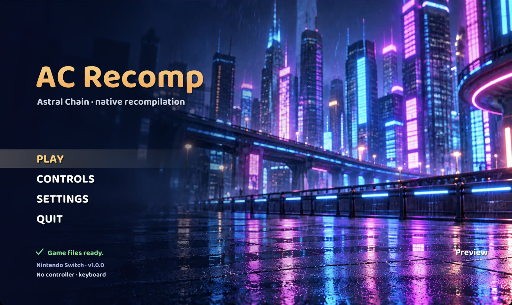

# AC-Recomp

> [!IMPORTANT]
> **This project was built with heavy AI assistance.** Most of the code, tooling, reverse engineering and
> documentation in this repository was written by an AI model (Anthropic's Claude, through Claude Code), directed,
> tested and reviewed by the project's owner. It is shared as is, as a fan project. If you prefer not to use
> AI-written code, you are free to skip it. As with any code from the internet, you build and run it at your own
> discretion.

**AC-Recomp** is an experimental native static recompilation of *Astral Chain* (Nintendo Switch, 2019) for macOS, with Linux and Windows ports in progress.

iOS/iPadOS is paused; see the `ios-archive` tag.

> [!NOTE]
> Platforms:
> - **macOS** - Apple silicon only, Vulkan on Metal through MoltenVK. The primary target and the only platform in
>   the current preview release.
> - **Linux** - x86-64, Vulkan. **Early:** reaches the File 01 motorcycle chase (headless-tested); see [Linux](#linux).
> - **Windows** - x86-64, Vulkan. **Early:** plays through the File 01 motorcycle chase in a desktop window; see [Windows](#windows).

> [!NOTE]
> **No game files are included.** AC-Recomp needs your own legally dumped copy of *Astral Chain* **1.0.0** (base game,
> no update) as an NSP, plus your own console's keys. Instructions on how to obtain these will **not** be provided.
> The build tools import your dump on a Mac and recompile the game's code on your Mac or Windows PC. No game code, assets, shaders,
> fonts, keys or firmware are included in this repository or in any release.



*The macOS launcher after setup. The art is original and AI-generated and depicts no game characters; no game content is shown.*

## Status

This is an early **preview**. The game is **not** complete or playable from start to finish. Expect crashes and
rendering bugs. Everything below was observed on the developer's machine and is not a guarantee for other setups.

Working on macOS (Apple silicon):

- Boots through the opening sequence.
- Character creation, with the system fonts from your firmware.
- The File 01 motorcycle chase, at a stable 30 fps on an Apple M5 Pro in our testing.
- Audio.

A build made by `tools/acr_build.py` from a real dump completes every stage, and its lifted code and all 1,332
translated shaders are byte-identical to the development build's.

### Known issues

- The game is not complete or playable end to end. Saving and reloading are untested.
- Only *Astral Chain* 1.0.0 (base game, no update) is supported; other versions are refused.
- The first boot cutscene cannot be skipped and lasts about five minutes.
- Without your firmware's shared fonts, open-licensed replacement fonts (Noto Sans) are used. Their in-game
  appearance is not yet verified, and button icons and Chinese, Japanese and Korean text do not display with them.
- The first build takes a while (30 to 90 minutes) and needs about 25 GB of free space.

The notes in [`docs/`](docs/) record each runtime change and its evidence. Many are dated working notes and may
describe states that later changes superseded.

## Features

- **This is not emulation.** The game's Arm code is statically recompiled to C++ ahead of time and compiled into a
  native program. There is no CPU emulator or JIT. The Switch OS services and the NVN graphics API are reimplemented
  on the host: NVN runs on Vulkan, and the game's shaders are translated offline to SPIR-V.
- **macOS launcher** (start screen) with Play, Controls and Settings: every controller button and keyboard key can be
  remapped, and settings are saved between runs. See [docs/ASTRAL_LAUNCHER.md](docs/ASTRAL_LAUNCHER.md).
- **Performance HUD**, switched on in the launcher's Settings (or `NX_PERF_HUD=1`): Apple's Metal Performance HUD
  on macOS, MangoHud on Linux when installed, and a built-in HUD otherwise (F3 toggles MangoHud and the built-in
  HUD).
- **FSR 1 upscaling** (AMD FidelityFX) of the game's 1600x900 image to your window: "Upscaling: FSR 1" in the
  launcher's Settings, or `NX_UPSCALE=fsr`.
- **Experimental build options**: `--render-res WxH` renders internally at a higher resolution (for example
  `2560x1440`, tested through the opening only), and `--fps 60` builds a 60 fps mode (smoke-tested through the
  opening; battle, gameplay timing and audio sync are not yet checked). They can be combined. See
  [docs/ASTRAL_RENDER_RES.md](docs/ASTRAL_RENDER_RES.md) and [docs/ASTRAL_60FPS.md](docs/ASTRAL_60FPS.md).
- **Touch screen** through the mouse: hold the left button over the window.
- **Audio**, with optional full-session audio capture.

## Installation

### macOS (Apple silicon)

Requirements: a Mac with Apple silicon, macOS 13 or newer, about 25 GB of free disk space, an internet connection
for the first build, your own *Astral Chain* 1.0.0 NSP and your console's keys (and title keys if your dump
needs it).

**The easy way: AC-Recomp Setup.** Download `AC-Recomp-v0.1.0-macos.dmg` from the latest release, open it, open
**AC-Recomp Setup** and follow the steps. It checks and helps install the build tools (each install command is shown
and runs in Terminal), asks for your NSP and keys (it passes their paths to the build and never copies them), and
builds `AC-Recomp.app` on your Mac with a live log; you can cancel and resume at any time. The app is not notarized,
so macOS blocks the first launch. On macOS 15 and later, try to open it once, then click **Open Anyway** in
**System Settings > Privacy & Security**. On macOS 13 and 14, right-click it and choose **Open**. Or, after dragging
it to Applications, run `xattr -dr com.apple.quarantine "/Applications/AC-Recomp Setup.app"`. See
[docs/SETUP_APP.md](docs/SETUP_APP.md).

**Advanced: the command line.** The setup app runs exactly these steps:

1. Install the Xcode command-line tools:

   ```sh
   xcode-select --install
   ```

2. Install [Homebrew](https://brew.sh), then the build dependencies and the .NET 10 SDK (used by the offline shader
   translator). Open a new terminal afterwards.

   ```sh
   brew install cmake ninja pkg-config sdl3 opus molten-vk vulkan-headers spirv-tools zstd
   brew install --cask dotnet-sdk
   ```

   If `python3 --version` is older than 3.11, also run `brew install python`.

3. Download the latest release (or clone this repository) and open a terminal in its folder.

4. Build. This imports your dump, recompiles the game's code to C++, translates its shaders, applies the runtime
   patches, builds the runtime and writes `AC-Recomp.app`:

   ```sh
   python3 tools/acr_build.py --nsp "/path/to/Astral Chain.nsp" --keys /path/to/keys \
     [--title-keys /path/to/title-keys] [--fonts /path/to/shared-fonts] --out ~/AC-Recomp-build --jobs 4
   ```

   The script checks every prerequisite first and says how to install anything missing. If a step fails, fix what
   the message says and run **the same command again**: finished stages are skipped. `--dry-run` shows every
   command without running it.

5. Open `~/AC-Recomp-build/AC-Recomp.app`, or drag it to your Applications folder first. The launcher comes up;
   **PLAY** starts the game. Keep the build folder: the app reads your imported game files and saves from its
   `data/` directory.

> [!NOTE]
> Everything the build produces comes from your own dump. Do not share the app, the build folder or anything in it.

[docs/BUILDING.md](docs/BUILDING.md) has the details: stages and timings, every option, the output layout and
troubleshooting.

#### Using your console's fonts

The game draws its text with the Switch's shared system fonts. Open-licensed replacements are used by default.
Switch fonts are Nintendo IP: you may provide them from your own hardware for an authentic look. Put the six
`.bfttf` files, unchanged, in one directory and pass it with `--fonts`, or later with
`--from-stage fonts --fonts <dir>`:

```
nintendo_udsg-r_std_003.bfttf        standard (JP/US/EU)
nintendo_udsg-r_org_zh-cn_003.bfttf  Chinese simplified
nintendo_udsg-r_ext_zh-cn_003.bfttf  Chinese simplified extension
nintendo_udjxh-db_zh-tw_003.bfttf    Chinese traditional
nintendo_udsg-r_ko_003.bfttf         Korean
nintendo_ext_003.bfttf               Nintendo extended (button icons)
```

The runtime reads them from `NX_SHARED_FONT_DIR`, or `<data root>/shared-fonts`, and stops with an error if one is
missing or does not decode to a TrueType/OpenType font. See
[docs/ASTRAL_SHARED_FONT_SWKBD.md](docs/ASTRAL_SHARED_FONT_SWKBD.md).

### Linux

> [!NOTE]
> **In progress.** Linux is not part of the current release, and its build is not scripted yet.

<!-- LINUX-STATUS -->
**Early, headless-tested.** On x86-64 Linux with an NVIDIA GPU (Ubuntu 22.04, Vulkan; tested on a cloud NVIDIA A40
with scripted input), the game runs through the title screen, opening cutscene, character creation and the File 01
motorcycle chase. The title runs at about 30 fps and the opening cutscene at 23 to 30 fps; the chase averages about 23 to 26 fps, with frame-time
spikes while textures load, and still shows some road/bike occlusion and glyph rendering bugs. One test run crashed
in the chase; the cause is not yet known. Opt-in texture-upload settings (`NX_LINUX_STAGING_CACHED=1`,
`NX_LINUX_STAGING_POOL=1`) and shader prewarm (`NX_SHADER_PREWARM=1`) are available but not yet on by default.
A desktop window, audio and gamepad input are not tested yet, and building still needs a Mac to produce the
recompiled code. Build notes: [docs/ASTRAL_LINUX.md](docs/ASTRAL_LINUX.md) (patch series `runtime/patches/series.linux`).

### Windows

> [!NOTE]
> **Early.** On Windows x64 with an NVIDIA GPU, the game runs in a desktop window through the title screen, the
> opening cutscene, character creation and the File 01 motorcycle chase (tested on cloud VMs with scripted input).
> Audio and real gamepad play are not verified yet. Initial dump import still needs a Mac; recompilation runs on
> Windows. Build notes:
> [docs/ASTRAL_WINDOWS.md](docs/ASTRAL_WINDOWS.md) (patch series `runtime/patches/series.windows`).

Performance, measured with the 60 fps frame-rate option on a cloud VM with an NVIDIA RTX PRO 6000:

- Shaders are cached after the first run, so later runs do not compile pipelines during play.
- With default settings the title runs at 60 fps, the opening cutscene at about 56 fps and the chase at about 52 fps,
  with displayed 1% lows near 26 to 27 fps in the chase.
- Eight opt-in settings together reach 60 fps in all three scenes, with displayed 1% lows near 56 fps in the
  chase. They are off by default until they pass visual, validation and long-session checks; see
  [docs/ASTRAL_WINDOWS_PERF.md](docs/ASTRAL_WINDOWS_PERF.md).
- **Known issue:** a long session can reach the runtime's 8 GiB memory guard after about 10 minutes of play, which
  stops the game. Desktop GPUs cannot read the game's ASTC textures directly, so they are expanded in memory.
  Opt-in fixes (`NX_WINDOWS_IMAGE_RETIRE_FIX=1`, `NX_WINDOWS_STREAM_UPLOADS=1`, `NX_WINDOWS_IMAGE_CACHE=1`) keep
  10-minute sessions under the guard in testing but are not yet on by default; see
  [docs/ASTRAL_WINDOWS_MEM.md](docs/ASTRAL_WINDOWS_MEM.md).

The Windows source zip contains **no game files**. Bring your own *Astral Chain* 1.0.0 dump and keys.

1. On a Mac, follow the prerequisites in [BUILDING.md](docs/BUILDING.md), then import your dump:

   ```sh
   python3 tools/acr_build.py --nsp "/path/to/Astral Chain.nsp" --keys "/path/to/keys" \
     --out ~/AC-Recomp-import --to-stage control
   ```

   Add `--title-keys "/path/to/title-keys"` if your dump needs them.
2. Copy the `exefs`, `analysis` and `extract` folders from
   `~/AC-Recomp-import/.local/game-private/astral/` to one folder on Windows, plus
   `~/AC-Recomp-import/work/control/receipt.json`. **Keep keys on the Mac.**
   Optionally copy your own completed Mac build's `data/spirv` and `data/shared-fonts` folders.
3. On a Windows PC with an AVX2-capable x64 CPU, a Vulkan 1.3+ graphics driver and at least 25 GB free, extract
   `AC-Recomp-<version>-windows.zip` and double-click **AC-Recomp Setup.cmd**.
   Enter the imported folder, receipt, optional shader/font folders and install location.
4. Setup checks Python, Git, Visual Studio C++ Build Tools and shader tools, and prompts before installing
   missing prerequisites. The first build needs internet and can take an hour or more.
   To translate shaders on Windows, install .NET 10, SPIRV-Tools and `zstd.dll`; reusing your own shaders skips them.
5. Open **AC-Recomp** from Start or the desktop, choose a frame rate, and click **Play**.
   Keep the import and install folders in place. Saves are in the install's `data/user` folder.

Setup is unsigned and runs only after you choose to open it. The game and launcher executables, including their
icons, are built on your PC. If setup stops, fix the printed error and rerun with the same paths to resume.
See [Windows setup](ports/windows/README.md) for installer details, logs and command-line options.

## Building from source

The macOS steps above are the build from source: releases contain only the build tools, runtime patches, launcher
art and documentation, and `tools/acr_build.py` does the rest on your machine.

The project is a set of patches on top of the MIT-licensed
[SuperMarioWonderRecomp](https://github.com/BelmanteGu/SuperMarioWonderRecomp) runtime, pinned at revision
`010ed7a596a621c15d3a8dfa5795ca8c3668b066`. This repository holds the runtime patches, Python tooling around the
pinned upstream importer and runtime, port glue, tests and notes.

- The runtime patches are applied in the order listed in `runtime/patches/series.macos`.
- The game code is lifted with the pinned upstream recompiler (`main` at `0x4000000000`, `sdk` at `0x4010000000`)
  plus `astral-sqshl.patch`.
- The shaders are translated offline with the pinned MIT-licensed shader translator (see THIRD_PARTY_NOTICES.md).
- Useful settings: `NX_PERF_HUD=1` (HUD), `NX_UPSCALE=fsr` (FSR 1), `NX_PLAYER_NAME` (the software-keyboard answer),
  `NX_LOG=<file>` and `NX_TRACE=1` (logging). The `docs/` notes list more.

Some older tools still carry checks tied to the original private development history, such as pinned commit
identities and receipts from earlier work. They may refuse to run against a fresh checkout until generalized.
`tools/acr_build.py` does not depend on them.

### Tests

The tests use only the Python standard library, and many run on synthetic fixtures alone. Many others do not:

- About 40 tests **fail** rather than skip unless you provide a clean checkout of SuperMarioWonderRecomp at the
  pinned revision. You pass it through variables such as `HID_REFERENCE`, `NVN_REFERENCE`, `APM_REFERENCE` or
  `WINDOWS_REFERENCE`; the failure message names the one each test needs.
- Some of those tests also need the Vulkan headers or a local CMake.
- Some tests check evidence kept in private storage on the developer's machine, and fail or skip without it.

```sh
python3 -m unittest discover -s tests -p 'test_*.py'
```

## Legal

AC-Recomp is an unofficial fan project. It is not affiliated with, endorsed by or sponsored by Nintendo or
PlatinumGames. *Astral Chain* and Nintendo Switch are trademarks of Nintendo; the names are used only to say which
game this project works with.

- This repository and its releases contain no Nintendo or PlatinumGames code, assets, shaders, fonts, keys or
  firmware, and none will be accepted. Do not attach dumps, keys, firmware, extracted files, generated code or
  translated shaders to issues or pull requests.
- Requests for help obtaining the game, keys or firmware other than from your own hardware will be closed. This
  project is not for use with copies of the game you do not own.
- You are responsible for the game, keys and any Switch system files you use: they must come from your own hardware and
  your own legally purchased copy.
- The launcher art is original, AI-generated artwork and depicts no game characters.
- Rights holders with a concern can open an issue on this repository; we will respond promptly.
- The original code here is MIT licensed ([LICENSE](LICENSE)). Third-party components keep their own licenses. The
  license grants nothing in the game itself, which you must supply yourself.

## Acknowledgements

> [!NOTE]
> **Thank you to [LASRecomp](https://github.com/peiikai/LASRecomp) and
> [SuperMarioWonderRecomp](https://github.com/BelmanteGu/SuperMarioWonderRecomp).** AC-Recomp stands on their
> work. SuperMarioWonderRecomp provides the runtime, importer, recompiler and shader pipeline this project is built
> on, and LASRecomp showed the way for a native Switch recomp you build from your own game files, from its start
> screen and settings to its README. Please check out and support both projects.


## Credits

- [SuperMarioWonderRecomp](https://github.com/BelmanteGu/SuperMarioWonderRecomp) by BelmanteGu: the runtime,
  importer, recompiler and shader harness this project patches (MIT).
- [LASRecomp](https://github.com/peiikai/LASRecomp) by Peiikai: inspiration for the "bring your own game files"
  build, the launcher and this README.
- [MacNativeGames](https://github.com/ly05010419/MacNativeGames): research reference for the render-resolution and
  60 fps patch approach (MIT; ideas only, no code taken).
- [letsgo-recomp](https://github.com/raulzrrs/letsgo-recomp): the hwopus service adaptation (MIT).
- An MIT-licensed shader translator, used as a build tool to translate shaders.
- [AMD FidelityFX Super Resolution 1](https://github.com/GPUOpen-Effects/FidelityFX-FSR): the FSR 1 upscaler, through
  the pinned runtime's FSR passes (MIT).
- [font8x8](https://github.com/dhepper/font8x8) by Daniel Hepper: the built-in performance HUD's font (public domain).
- [stb_truetype and stb_image](https://github.com/nothings/stb) by Sean Barrett: launcher text and art decoding
  (public domain or MIT).
- [Baloo 2](https://github.com/EkType/Baloo2) by Ek Type: the launcher's font (SIL Open Font License 1.1,
  `assets/launcher/OFL.txt`).
- [Noto Sans](https://github.com/notofonts) by the Noto Project Authors: the replacement game font, downloaded at
  build time (SIL Open Font License 1.1).
- SDL3, the Vulkan headers and loader, MoltenVK, libopus and the Python packages listed in
  `THIRD_PARTY_NOTICES.md`, under their own licenses.

Full license texts and notices are in [THIRD_PARTY_NOTICES.md](THIRD_PARTY_NOTICES.md) and next to the patches that
use them.
